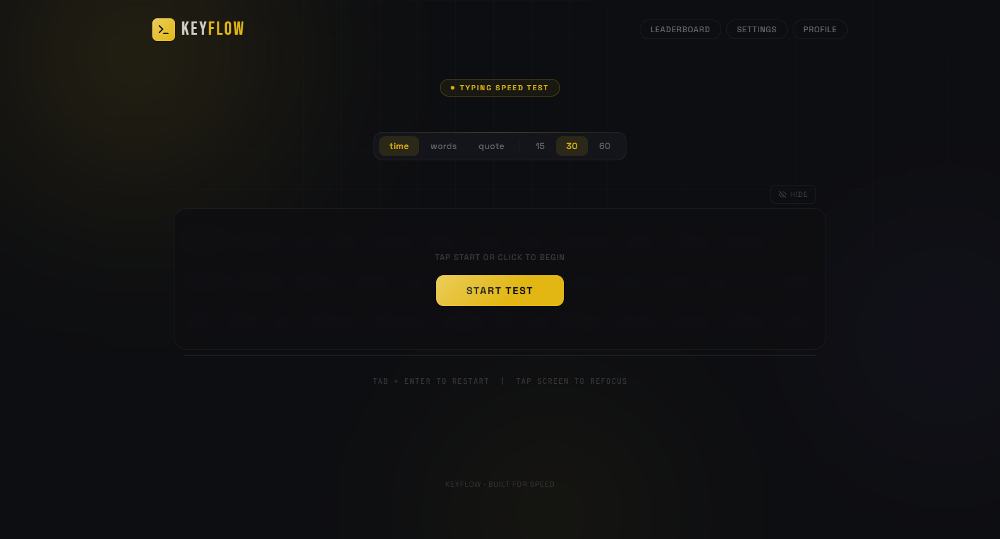
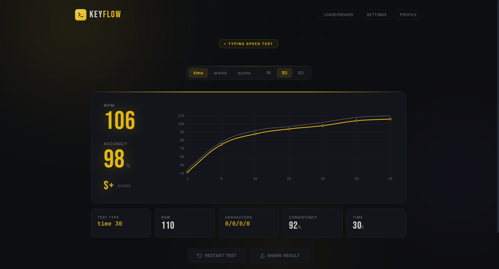

# Speed-Typing

<p align="center">
  
  
  
  
  
</p>

**Keyflow** is a sleek, distraction-free typing speed test application featuring dynamic test modes, real-time character accuracy validation, tier skill rankings, and interactive Chart.js velocity graphs.

---

## 📸 Hero Preview

<p align="center">
  
</p>

## 🖼️ Post-Test Performance Dashboard

<p align="center">
  
</p>

---

## 🎮 Test Modes & Controls

| Mode | Options | Description |
|---|---|---|
| **Time** | `15s` / `30s` / `60s` | Race against the countdown timer |
| **Words** | `10` / `25` / `50` words | Fixed word quota for raw consistency |
| **Quote** | `Short` / `Medium` / `Large` | Famous movie, literature, and anime quotes |
| **Quick Restart** | `Tab` / `Enter` | Instantly reset test and regenerate word pool |

---

## ✨ Features

- ⚡ **Zero-Latency Typing Engine** - Instant character-by-character feedback with active caret tracking and error highlights.
- 📊 **Comprehensive Analytics** - Real-time Net WPM, Raw WPM, accuracy %, consistency rating, and character error counts.
- 📈 **Interactive Velocity Graphs** - Second-by-second speed curve visualization powered by Chart.js.
- 🏅 **Skill Tier Grading** - Automatic rank evaluation (`S+`, `S`, `A`, `B`, `C`, `D`) based on speed and accuracy.
- 🌌 **Minimalist Cyberpunk Aesthetic** - Floating glowing ambient orbs, dark glassmorphism surfaces, and Space Grotesk typography.

---

## 🛠️ Tech Stack

- **Core**: Vanilla JavaScript (ES6+), HTML5, Modern CSS3
- **Data Visualization**: Chart.js v4
- **Typography**: Space Grotesk, JetBrains Mono, Bebas Neue

---

## 🚀 Quick Start

### 1. Clone the repository
```bash
git clone https://github.com/soorajstudio/Speed-Typing.git
cd Speed-Typing
```

### 2. Run locally
```bash
# Using Python
python -m http.server 8080

# Or using Node
npx serve .
```

Open [http://localhost:8080](http://localhost:8080) in your browser.

---

## 📄 License

This project is licensed under the MIT License — see the [LICENSE](LICENSE) file for details.

Developed with ❤️ by [Sooraj Studio](https://github.com/soorajstudio).
